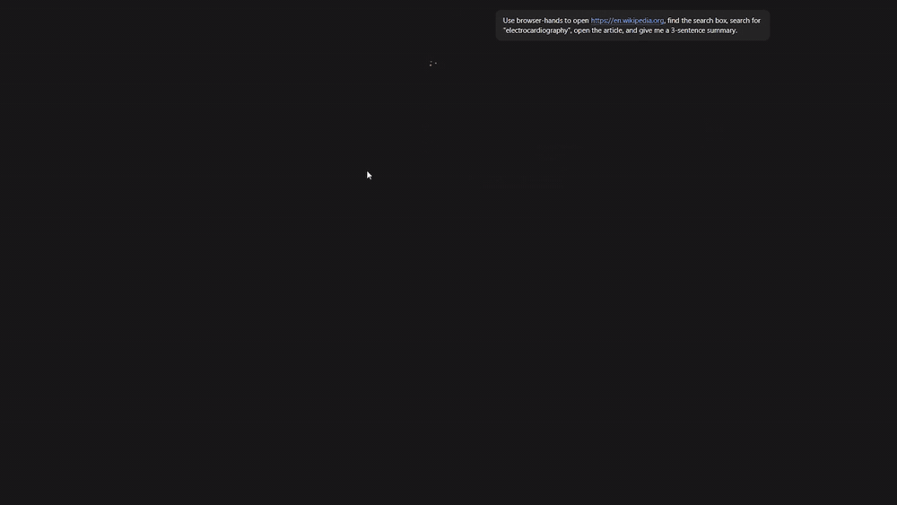

# browser-hands

An open-source **MCP server** that gives AI assistants hands in a real web browser. Connect it to Claude (or any MCP client) and the AI can open pages, read them, find buttons and inputs, click, and type.



*Claude driving Microsoft Edge through browser-hands: open Wikipedia → type into search → open the article → summarize. (Middle section sped up.)*

## Tools

| Tool | What it does |
|---|---|
| `open_page` | Navigate to a URL; returns the final URL and title |
| `read_page` | Return the page's visible text, capped to fit an AI's context |
| `list_elements` | List visible links, buttons, and inputs, each with a numbered `ref` |
| `click_element` | Click an element by its `ref` |
| `fill_element` | Type into an input by its `ref` |

## How it works

```
AI client (Claude Desktop)
      │  MCP over stdio
      ▼
src/server.ts   – registers tools, validates inputs with zod
      │
      ▼
src/browser.ts  – Playwright functions that drive the browser
      │
      ▼
Microsoft Edge
```

The browser layer knows nothing about MCP, so it can be reused on its own.

## Design decisions

- **Numbered element refs.** Language models are unreliable at writing CSS selectors but reliable at saying "click #3". `list_elements` tags each visible element with a `data-bh-ref` attribute, and the action tools target that number.
- **Visible-only elements.** Zero-size and hidden elements are filtered out so the agent only sees what a person could interact with.
- **Context-aware page reading.** `read_page` collapses blank lines and caps output (`maxChars`, default 5000), with a `truncated` flag so the agent knows when it isn't seeing everything.
- **Persistent, self-healing session.** One browser and tab are reused across calls so multi-step tasks work. If the window is closed or crashes, a liveness check and disconnect listener relaunch it on the next call instead of failing.
- **Validated inputs.** Every tool's arguments are checked with zod schemas before touching the browser.
- **Clean stdio.** Logs go to stderr; stdout is reserved for MCP protocol messages.

## Setup

Requires Node.js 20+ and Microsoft Edge (preinstalled on Windows).

```bash
git clone https://github.com/ArifMojid/browser-hands.git
cd browser-hands
npm install
```

Test with the MCP Inspector:

```bash
npx @modelcontextprotocol/inspector npx tsx src/server.ts
```

### Connect to Claude Desktop

Add this to `claude_desktop_config.json` (Settings → Developer → Edit Config), adjusting the paths:

```json
{
  "mcpServers": {
    "browser-hands": {
      "command": "node",
      "args": [
        "C:\\path\\to\\browser-hands\\node_modules\\tsx\\dist\\cli.mjs",
        "C:\\path\\to\\browser-hands\\src\\server.ts"
      ]
    }
  }
}
```

Fully quit and reopen Claude, then ask it to use browser-hands.

## Roadmap

- [ ] `press_key` and `screenshot` tools
- [ ] Action log for replaying and debugging runs
- [ ] Headless mode option
- [ ] Store readiness checker built on top of browser-hands

## Built with

TypeScript · Model Context Protocol SDK · Playwright · zod